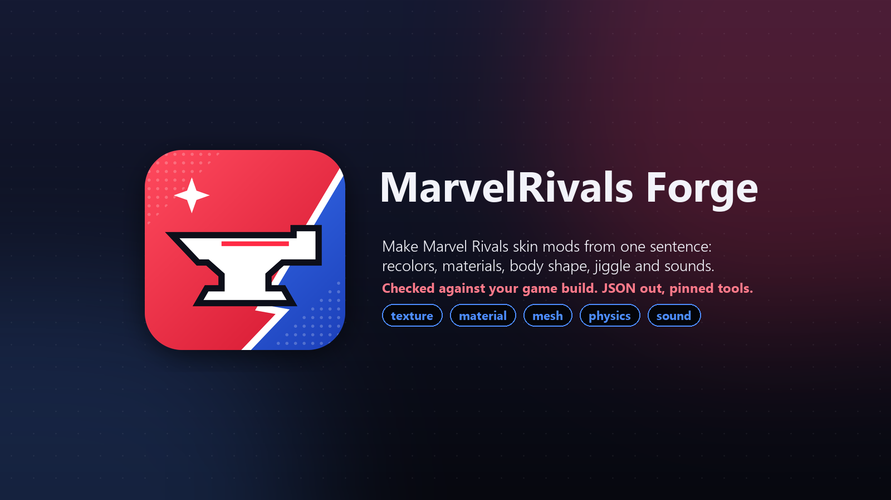
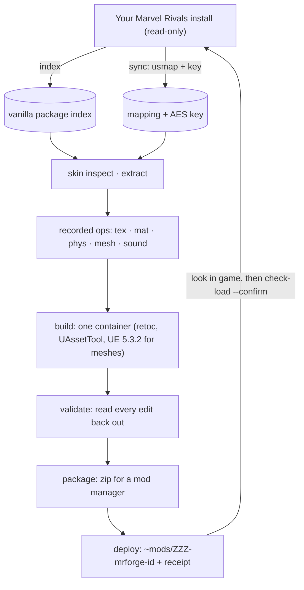

<div align="center">



[](https://github.com/SenjuWoo/MarvelRivals-Forge/actions/workflows/ci.yml)
[](https://github.com/SenjuWoo/MarvelRivals-Forge/releases)
[](pyproject.toml)
[](pyproject.toml)
[](LICENSE)

**[Install](#install)** · **[Tour](#a-two-minute-tour)** · **[Routes](#routes)** · **[Commands](#commands)** · **[How it works](#how-it-works)** · **[Changelog](CHANGELOG.md)**

</div>

MarvelRivals-Forge is a command-line forge for **Marvel Rivals skin mods**, built so an AI agent (or a person) can
go from "make this skin red", "add chest jiggle" or "give her claws a new sound" to a validated, packaged mod in a
handful of commands. It reads the game you have installed (build, loader, installed mods and every vanilla package
path) and builds against that. Textures, materials, physics and sounds need no Unreal Editor, and sounds need no
Wwise; mesh edits and lobby jiggle run Blender and Unreal Engine 5.3.2 headless.

## What you get

- **One CLI, JSON everywhere.** `mrforge <command>` prints one JSON object with `ok`, `data`, `errors` (each with a fix), `warnings` and `gaps`, and exits 0 ok, 1 failure, 2 usage, 3 environment. Add `--pretty` for indented output.
- **Pinned tools.** retoc-rivals-cli, UAssetTool, fmodel-mcp, the UEFormat Blender importer and the other helpers are fetched by `mrforge setup` from their GitHub releases and checked against SHA-256 hashes in `tools.lock.json`.
- **Facts from your install.** Game build, loader, installed mods and every vanilla package path are read from the game itself; the mapping file must match your exact game build.
- **Edits as recorded ops.** Hue, tint, levels, overlay, replace (with masks), material parameters and physics chains are replayed from vanilla on every build, so edits never stack or drift.
- **Physics without the editor.** Add KawaiiPhysics chains (chest/butt jiggle) or tune hair and cloth in the skin's own post-process AnimBlueprint; the vanilla anim graph stays untouched. Lobby (hero select) jiggle is built headless in Unreal 5.3.2.
- **Sounds without Wwise.** Replace a skin's weapon, ability and hero-select sounds with any audio file; the skin's own sound banks get the new audio in place and everything else in them stays byte for byte.
- **One mod, every route.** A project can combine texture, material, physics, mesh and sound edits; `build` packs them into one container and `validate` reads each one back out of it.
- **Evidence tiers.** `validate` proves the static, build and package tiers (including extracting the edited texture back out of the built mod); load and gameplay are recorded only from an in-game look.


## Install

Requirements: Windows, Python 3.10+, a Steam install of Marvel Rivals, and the ASI loader + UTOC signature bypass
for loading mods (`mrforge doctor` checks it). Unreal Engine 5.3.2 and Blender 4.2+ are needed only for the mesh
route; lobby jiggle also needs Visual Studio 2022 Build Tools (MSVC v143) for the forge's small editor plugin.

**Windows:** download the source zip from the [latest release](https://github.com/SenjuWoo/MarvelRivals-Forge/releases/latest), extract it, and run `START-HERE.bat`. Or from a shell:

```powershell
git clone https://github.com/SenjuWoo/MarvelRivals-Forge
cd MarvelRivals-Forge
.\Install.ps1            # venv + 'mrforge' on your PATH (or run .\mrforge.cmd without installing)
mrforge doctor
mrforge setup            # pinned tools into .mrforge\tools (add --from <folder> to adopt existing copies)
mrforge sync             # mapping (.usmap) for the installed build + AES key
mrforge index            # vanilla package index for this build (about 5 s)
mrforge selftest texture # end-to-end smoke run, never deploys
```

`Install.ps1 -Skills` also copies the agent skill into the AI tools it finds, `-DryRun` shows what it would do,
and `-SkipTests` skips the test suite. A second run converges. `Uninstall.ps1` removes the launcher, its PATH
entry and the skill copies, and keeps `.venv`, `.mrforge` and `projects`.

Run `mrforge setup`, `sync` and `index` again after every game patch.

## A two-minute tour

```powershell
mrforge plan "make Storm's suit red"
mrforge skin find "storm"
mrforge new "Red Storm" --skin 1015001 --kind texture
cd projects\red-storm
mrforge extract --textures "T_1015001_Body_*"
mrforge tex tint T_1015001_Body_D --color "#c01020" --strength 0.7
mrforge tex sheet        # look at build\preview\sheet.png
mrforge build
mrforge validate
mrforge package          # dist\RedStorm-0.1.0.zip for your mod manager
mrforge deploy           # optional: copies into ~mods\ZZZ-mrforge-red-storm\
```

Skin names come from a snapshot table; heroes added after it show by id only (`mrforge hero list`,
`mrforge skin inspect <skinId>`), and `mrforge catalog sync` refreshes the names from upstream.


Body shape and jiggle in one mod:

```powershell
mrforge new "Curvy Bounce" --skin <skinId> --kind texture,mesh,physics
cd projects\curvy-bounce
mrforge mesh export --lobby
mrforge mesh blend
mrforge mesh inflate --bone L_Breast_01_Jnt --bone R_Breast_01_Jnt --factor 1.2
mrforge mesh preview     # look at build\preview\<mesh>.png
mrforge mesh check
mrforge extract --physics
mrforge phys add-chain --root L_Breast_01_Jnt --root R_Breast_01_Jnt --preset jiggle
mrforge build            # one container: edited meshes (Unreal 5.3.2) + physics
mrforge validate
```

Lobby jiggle: `mrforge phys springs --region chest|butt|thighs` (or `--bone <bone>`). New sounds:
`mrforge extract --sounds`, `mrforge sound list "*left*"`, `mrforge sound replace <event> <audio file>`.

## Routes

| Route | What | Since |
|---|---|---|
| texture | recolor, retexture, logos, decals, skin tone | v0.1 |
| material | material instance tints, glow, roughness | v0.1 |
| mesh | body shape, outfit geometry edits (Blender + UE 5.3.2), in-match and lobby meshes; scripted `mesh inflate` | v0.2 |
| physics | add jiggle chains, tune hair/cloth/tail chains (KawaiiPhysics) in matches; spring-bone jiggle in the lobby / hero select (built headless in UE 5.3.2) | v1.0 / v1.1 |
| sound | replace the skin's weapon, ability, hero-select and MVP sounds with your own audio (wav/mp3/ogg); no Wwise | v1.2 |

`mrforge doctor` reports which routes your machine can run and what each one still needs.

## Commands

| Need | Command |
|---|---|
| Health check: payload, tools, game, data, routes | `mrforge doctor` |
| Every command and option, as JSON | `mrforge capabilities` |
| Cold-start runbook | `mrforge guide` |
| Route a request to exact commands | `mrforge plan "<request>"` |
| Knowledge docs and verified facts | `mrforge knowledge [topic]` · `mrforge facts [--grep x]` |
| Tools, mapping, index | `mrforge setup` · `mrforge sync` · `mrforge index` |
| Heroes, skins, what a skin contains | `mrforge hero list` · `mrforge skin find\|list\|inspect` · `mrforge catalog sync` |
| Installed mods and overlaps (read-only) | `mrforge mods` · `mrforge conflicts` |
| New project, version bump | `mrforge new <name> --skin <id> --kind texture,material,mesh,physics,sound` · `mrforge bump` |
| Vanilla assets of the skin | `mrforge extract --textures <glob> \| --materials \| --physics \| --sounds \| --all` |
| Edits | `mrforge tex ...` · `mrforge mat ...` · `mrforge phys ...` · `mrforge mesh ...` · `mrforge sound ...` |
| Release loop | `mrforge build` · `validate` · `package` · `deploy` · `undeploy` |
| Smoke runs on the real toolchain | `mrforge selftest texture\|physics\|mesh [--lobby]` |
| After an in-game look | `mrforge check-load [--confirm "<what you saw>"]` |

Global options anywhere on the line: `--game <folder>`, `--project <folder>`, `--pretty`.

## How it works



- **Vanilla always comes from the game containers**, never from installed mods.
- **Plain containers only.** Since Season 11 the game reports encrypted, obfuscated and stripped mods, so the forge never builds them and `doctor` lists installed mods that are.
- **Facts are data with sources.** Verified facts live in `src/mrforge/knowledge/facts.json` with a tier; routes and docs ship with the tool (`mrforge knowledge`).

## Safety

The forge never writes into the game folder except `mrforge deploy` into its own `ZZZ-mrforge-<id>` folder (with a
receipt that `undeploy` uses to remove exactly what it added), never edits mod-manager state, and only builds plain
containers. See [SECURITY.md](SECURITY.md).

## Tested

`python tests/run_tests.py` runs the offline suite with shims for both packing tools and synthetic game fixtures;
CI runs it on Windows and Linux for Python 3.10 and 3.13, fetches the pinned tools from their releases and checks
their versions, installs twice (the second run must converge) and uninstalls, and builds the release archive twice to prove it is deterministic.
The live smoke runs (`mrforge selftest ...`) need the game and run locally.

## License

MIT for this repository. The upstream tools keep their own licenses; see [THIRD-PARTY.md](THIRD-PARTY.md). Agent
runbook: [AGENTS.md](AGENTS.md).
